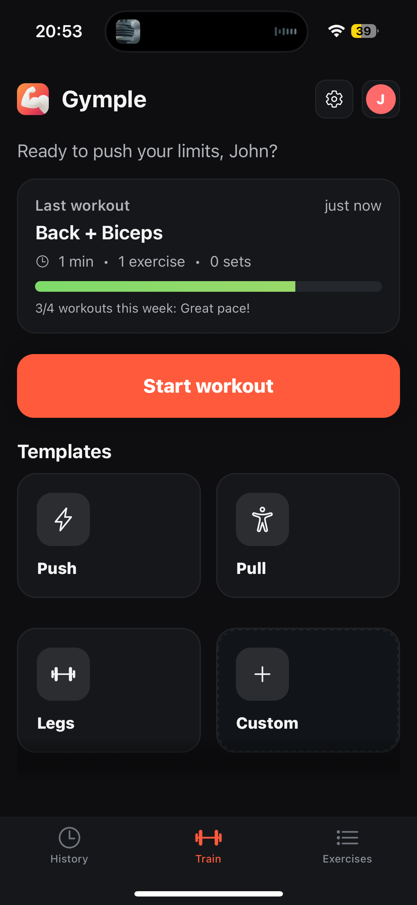
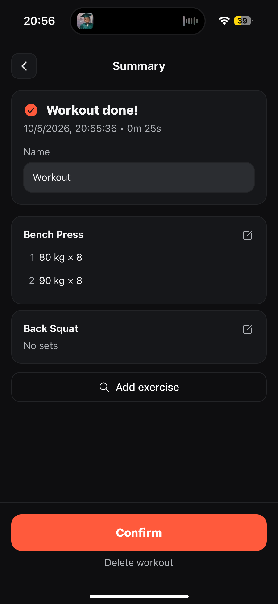
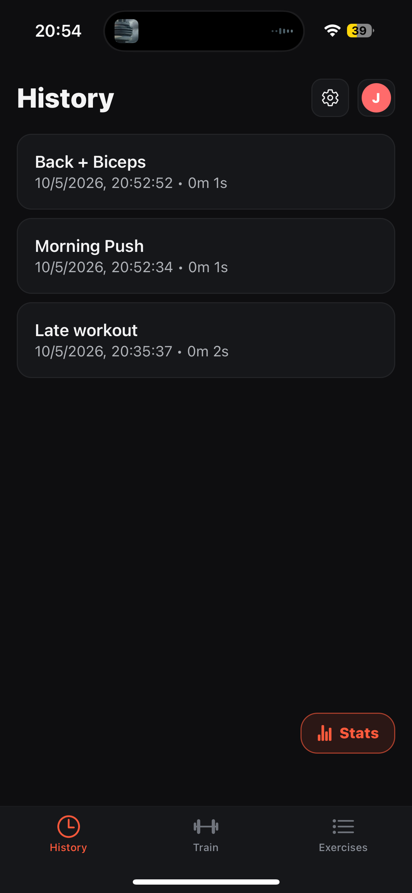
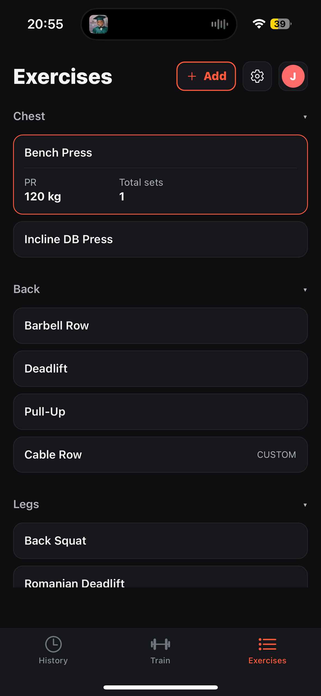
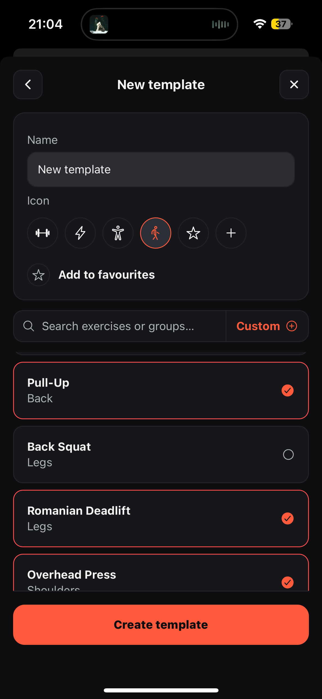
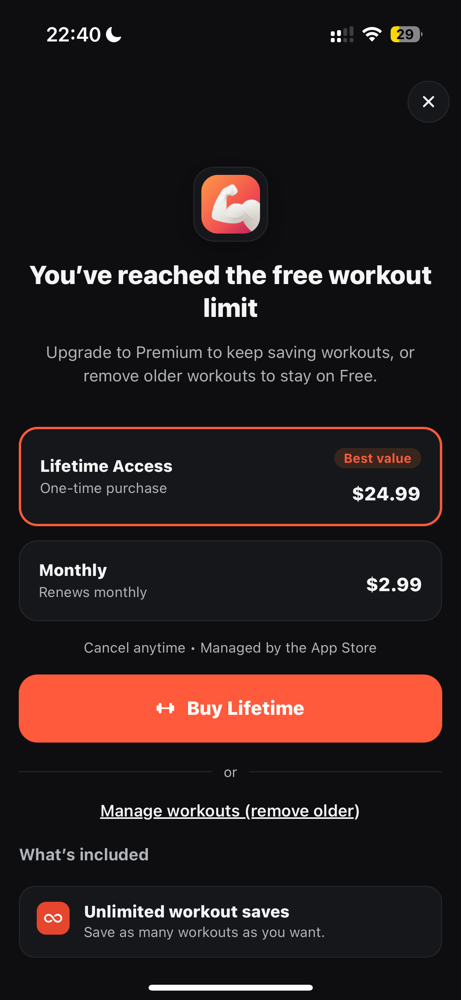

# Gymple

An iPhone workout tracker for logging sets, reusing routines and keeping a training history.

[Available on the App Store](https://apps.apple.com/us/app/gymple/id6756895779).

<table>
  <tr>
    <td><a href="docs/readme/01-train.png"></a></td>
    <td><a href="docs/readme/02-workout-details.png"></a></td>
  </tr>
</table>

## What I wanted to build

I built Gymple around a straightforward workout flow: choose a routine, record the exercises and sets, then save the session so it is easy to find later. The interface keeps the training log close at hand, with custom exercises and templates for routines that repeat.

I also wanted to take the app through the less visible parts of shipping a mobile product: signing in, storing data under the right account, restoring purchases, deleting an account and preparing an App Store release. Gymple went through TestFlight before its App Store release.

## Using it

Start a workout from scratch or choose a template. Add exercises, record sets with weights and reps, and finish the session. Saved workouts appear in the history, where their names and contents can be reviewed and edited.

<table>
  <tr>
    <td><a href="docs/readme/03-history.png"></a></td>
    <td><a href="docs/readme/04-exercises.png"></a></td>
  </tr>
</table>

The exercise library includes built-in movements and supports custom ones. Templates save a selection of exercises for the next session. The app supports kilograms and pounds, and includes English, Polish and Italian translations.

## How the app is put together

React Native and Expo handle the mobile interface. Supabase Auth handles email/password, Google and Apple sign-in; PostgreSQL stores each user's workouts, custom exercises and templates. RevenueCat connects the app's Premium entitlement to Apple In-App Purchases.

```text
iPhone app
    |-- Supabase Auth: sign-in and session
    |-- PostgreSQL: workouts, exercises and templates
    |-- RevenueCat / App Store: purchases and Premium status
    `-- Edge Function: authenticated account deletion
```

Workout records keep the session's name, timing and status in database columns, with the exercise-and-set details in a JSON payload. This lets the history load session summaries while keeping the full log together.

## A few implementation details

**Account boundaries live in the database too.** Data access uses the signed-in user's ID, and the schema defines Row Level Security policies for user-owned tables. A workout, template or custom exercise belongs to its creator.

**Custom exercises need predictable names.** Name checks trim whitespace and compare case-insensitively before saving. The release-hardening migration also defines per-user unique indexes for exercise and template names, so the database can reject duplicates as well as the interface.

**A purchase changes the current flow.** The Premium provider listens for RevenueCat customer updates. If a user reaches the free workout limit, saving can wait for the paywall result and continue when the entitlement becomes active. The app also includes purchase restoration.

**Deleting an account needs server-side work.** The account-deletion Edge Function validates the caller's bearer token, removes that user's related records and deletes the authentication account. The privileged database key stays in the function's environment.

<table>
  <tr>
    <td><a href="docs/readme/05-templates.png"></a></td>
    <td><a href="docs/readme/06-premium.png"></a></td>
  </tr>
</table>

*Screenshots show the app's training, history, exercise, template and purchase interfaces. Offers shown in screenshots may differ from the current App Store offer.*

## Built with

- **React Native, Expo and TypeScript** for the mobile app and navigation.
- **Supabase Auth and PostgreSQL** for accounts and user-owned training data.
- **Supabase Edge Functions** for the account-deletion backend.
- **RevenueCat and Apple In-App Purchases** for Premium purchases and entitlement updates.
- **GitHub Pages** for the privacy, terms and support pages in `docs/`.

## Running it locally

This repository contains the mobile client, database schema/reference files, the account-deletion Edge Function and static support pages. To run your own instance, configure your own services using [`.env.example`](.env.example).

```bash
npm install
cp .env.example .env
npm run start
```

Run the TypeScript check with:

```bash
npm run typecheck
```

Purchases do not run in Expo Go. Use a development build or TestFlight to test Apple In-App Purchases.

The database structure is documented in [supabase/schema.sql](supabase/schema.sql), with additional setup notes in [supabase/README.md](supabase/README.md). The account-deletion backend is in [supabase/functions/delete-account](supabase/functions/delete-account).

The purchase integration uses entitlement `premium`, offering `default`, and products `com.gymple.premium.monthly` and `com.gymple.premium.life`. Further release/setup notes are in [docs](docs).
